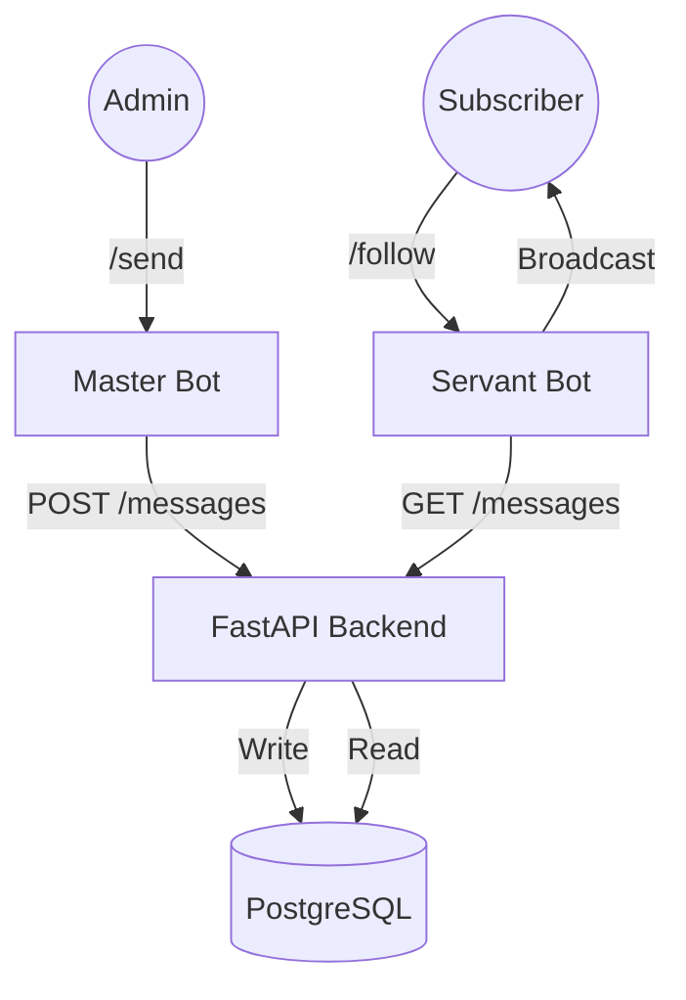

# BroadcastBot System 📡

**Distributed anonymous messaging platform utilizing a Microservices-based architecture.**


## 📖 Overview

BroadcastBot is not just a chatbot; it is a system designed to decouple the **input source** (Master) from the **distribution layer** (Servant). This separation ensures security and scalability.

The system consists of three distinct services orchestrated via Docker Compose:
1.  **Master Bot:** An interface for authorized administrators to inject messages.
2.  **API Gateway (FastAPI):** Central hub for business logic and database interactions.
3.  **Servant Bot:** A distribution worker that polls the API and delivers content to subscribers.

### 🏗 System Architecture



## 🚀 Key Features

* **Decoupled Architecture:** The sender (Master) and receiver (Servant) logic are isolated in different containers.
* **Persistent History:** All messages are stored in PostgreSQL. If a user unsubscribes and later resubscribes, they receive the "missed" backlog (History Recovery).
* **Security:**
    * **Master Access:** Protected by a secret token (`MASTER_TOKEN`).
    * **Subscription Control:** Public access can be restricted via a registration token (`SERVANT_REG_TOKEN`).
* **Dockerized Deployment:** One-command setup for DB, API, and Bots.

## 🛠 Tech Stack

* **Languages:** Python 3.12
* **Frameworks:** FastAPI (API), Aiogram 3.x (Bots)
* **Database:** PostgreSQL
* **DevOps:** Docker, Docker Compose

## ⚙️ Installation & Setup

### 1. Clone the repository
```bash
git clone https://github.com/S1erben13/broadcast_bot.git
cd broadcast_bot
```

### 2. Environment Configuration
Create a `.env` file in the root directory. You can use `.env.example` as a reference.

**Required Variables:**
```ini
# Database
POSTGRES_USER=admin
POSTGRES_PASSWORD=admin
POSTGRES_DB=broadcast_db

# Security Tokens
MASTER_TOKEN=your_secret_master_token
SERVANT_REG_TOKEN=your_public_invite_token

# API Configuration
API_BASE_URL=http://api:8000
```

### 3. Deploy with Docker
```bash
docker-compose up --build -d
```
*The `-d` flag runs containers in the background.*

## 🎮 Usage Guide

### For Administrators (Master Bot)
1.  **Auth:** Send `/register <MASTER_TOKEN>` to authorize yourself as a sender.
2.  **Send:** Any text or media sent to the bot will be processed by the API and queued for distribution.

### For Users (Servant Bot)
1.  **Subscribe:** Send `/follow <SERVANT_REG_TOKEN>` (token required for the first time only).
2.  **Manage:** Use `/unfollow` to stop receiving messages and `/follow` (no token) to resume.
3.  **Sync:** Upon resubscribing, the bot will fetch missed messages from the API.

## 🔌 API Reference

The internal API service runs on port `8000`.

* `POST /messages` - Save a new broadcast message.
* `GET /messages` - Fetch messages (supports pagination/offset).
* `POST /users` - Register a new subscriber.
* `PATCH /users/{id}` - Update subscriber status.

---
*Created by [Vladimir Popov](https://github.com/S1erben13)*
